<p align="center">
<picture>
  <source media="(prefers-color-scheme: dark)" srcset="docs/readme/hero-dark.png">
  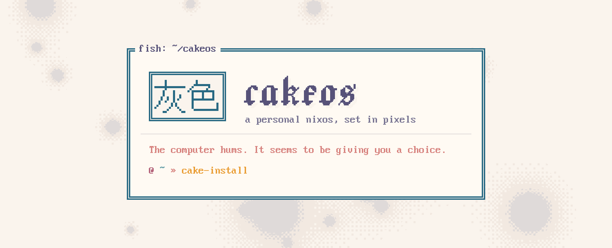
</picture>
</p>

CakeOS is my NixOS, as a flake: one host, three desktops, a graphical installer, and a look of its own called **haiiro**. This page is the look first, then the system.

<p align="center"><a href="#design">design</a> · <a href="#cakeos">cakeos</a> · <a href="#install">install</a> · <a href="#options">options</a> · <a href="#claude--apple">claude + apple</a></p>

<h2 id="design">
<picture>
  <source media="(prefers-color-scheme: dark)" srcset="docs/readme/h-design-dark.png">
  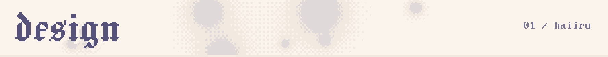
</picture>
</h2>

haiiro is the look of [haiiro.moe/~cakes](https://haiiro.moe/~cakes/): a lone terminal floating in the night. Rosé Pine colours, a bitmap font, square corners, dithered pixels. The shell, the login screen, the installer and the boot menus all draw from the same tokens.

<h3 id="palette">
<picture>
  <source media="(prefers-color-scheme: dark)" srcset="docs/readme/s-palette-dark.png">
  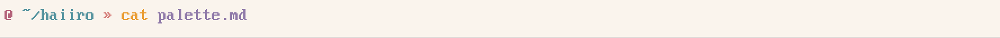
</picture>
</h3>

<p>
<picture>
  <source media="(prefers-color-scheme: dark)" srcset="docs/readme/palette-dark.png">
  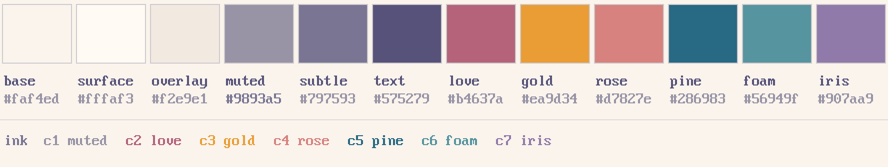
</picture>
</p>

Pine frames things, foam reads, rose narrates, gold is for commands. One theme, dark.

<h3 id="type">
<picture>
  <source media="(prefers-color-scheme: dark)" srcset="docs/readme/s-type-dark.png">
  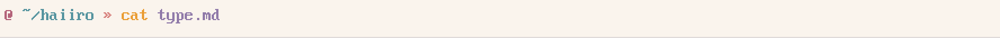
</picture>
</h3>

<p>
<picture>
  <source media="(prefers-color-scheme: dark)" srcset="docs/readme/type-dark.png">
  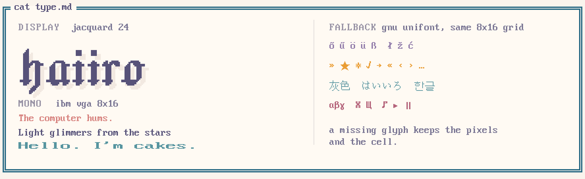
</picture>
</p>

Jacquard 24 for titles, IBM VGA 8x16 for everything else, GNU Unifont underneath for whatever they lack, on the same 8x16 grid.

<h3 id="pixels">
<picture>
  <source media="(prefers-color-scheme: dark)" srcset="docs/readme/s-pixels-dark.png">
  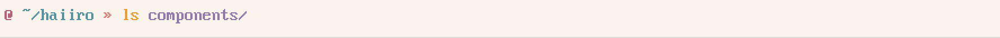
</picture>
</h3>

<p>
<picture>
  <source media="(prefers-color-scheme: dark)" srcset="docs/readme/components-dark.png">
  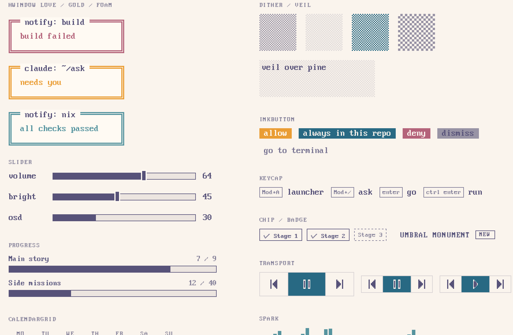
</picture>
</p>

Square corners, no shadows. A double pine frame makes a window; hairlines, dashed when inactive, do the rest.

<h3 id="motion">
<picture>
  <source media="(prefers-color-scheme: dark)" srcset="docs/readme/s-motion-dark.png">
  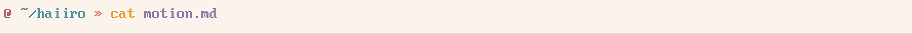
</picture>
</h3>

<p>
<picture>
  <source media="(prefers-color-scheme: dark)" srcset="docs/readme/motion-dark.png">
  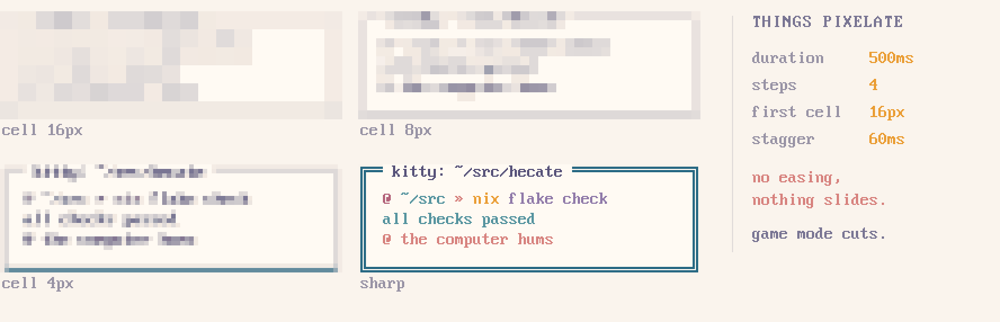
</picture>
</p>

Things pixelate in and out. Nothing slides or eases.

<h3 id="blobs">
<picture>
  <source media="(prefers-color-scheme: dark)" srcset="docs/readme/s-blobs-dark.png">
  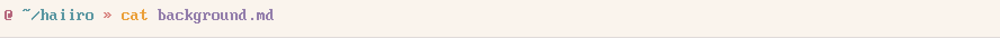
</picture>
</h3>

<p>
<picture>
  <source media="(prefers-color-scheme: dark)" srcset="docs/readme/blobs-dark.png">
  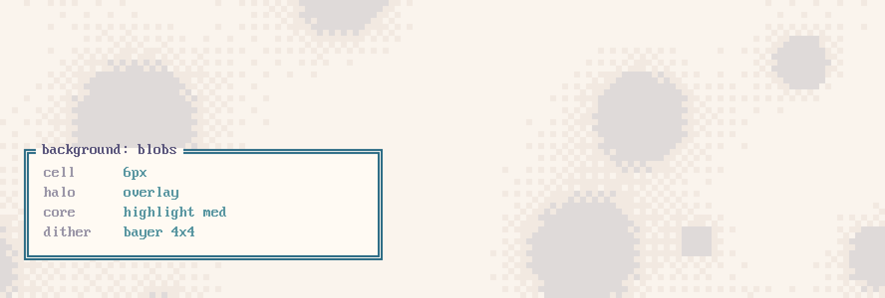
</picture>
</p>

The background is a live simulation of dithered blobs, not a wallpaper (wallpapers are opt-in). The login screen always shows it.

<h3 id="desktop">
<picture>
  <source media="(prefers-color-scheme: dark)" srcset="docs/readme/s-desktop-dark.png">
  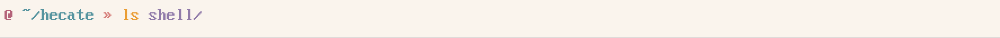
</picture>
</h3>

The haiiro shell is part of [hecate](https://github.com/Kex1016/hecate), the compositor CakeOS ships as its default desktop. Screens below are renders of the real shell.

<p>
<picture>
  <source media="(prefers-color-scheme: dark)" srcset="docs/readme/launch-dark.png">
  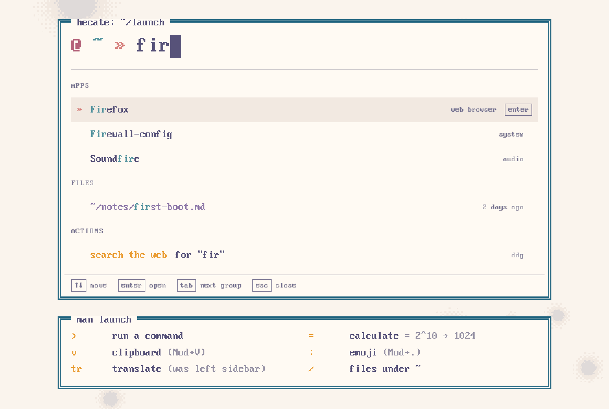
</picture>
</p>

<p>
<picture>
  <source media="(prefers-color-scheme: dark)" srcset="docs/readme/settings-dark.png">
  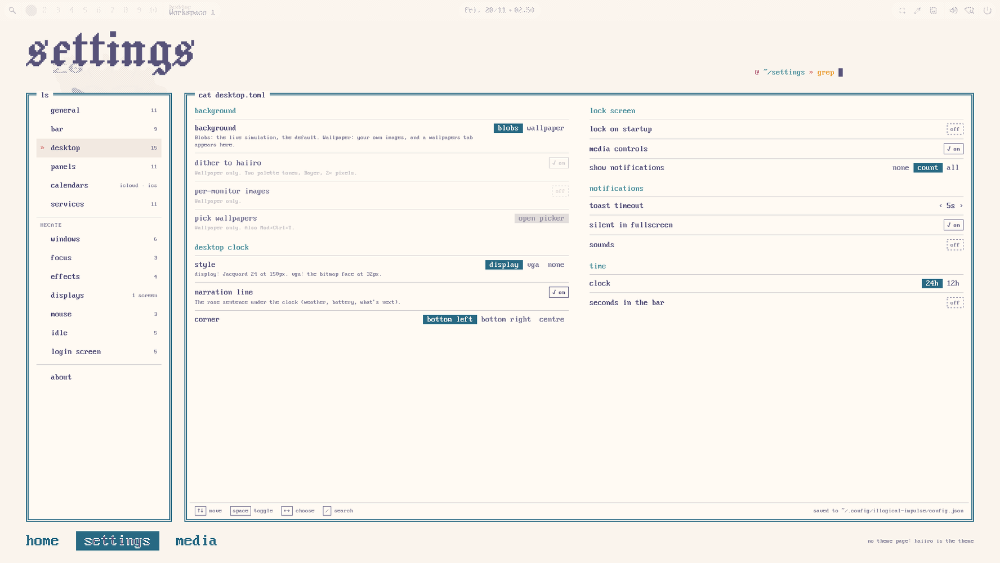
</picture>
</p>

<p>
<picture>
  <source media="(prefers-color-scheme: dark)" srcset="docs/readme/widgets-dark.png">
  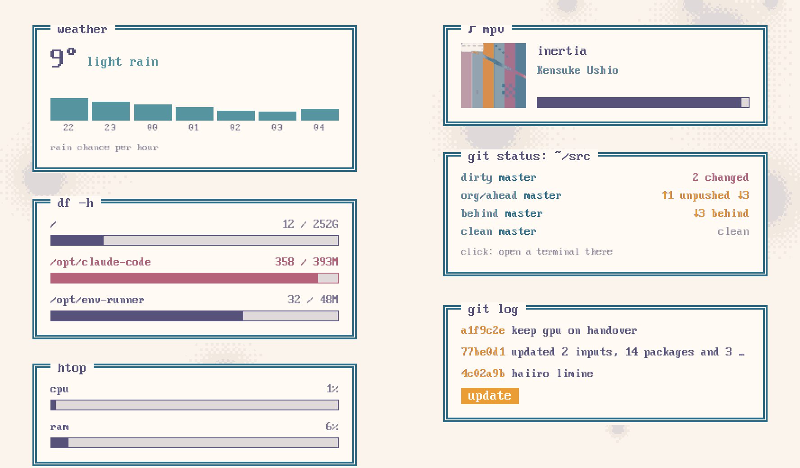
</picture>
</p>

<p>
<picture>
  <source media="(prefers-color-scheme: dark)" srcset="docs/readme/login-dark.png">
  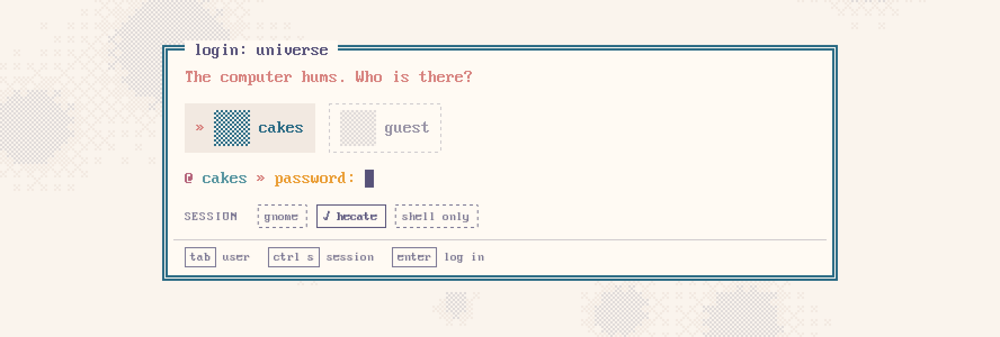
</picture>
</p>

<h2 id="cakeos">
<picture>
  <source media="(prefers-color-scheme: dark)" srcset="docs/readme/h-cakeos-dark.png">
  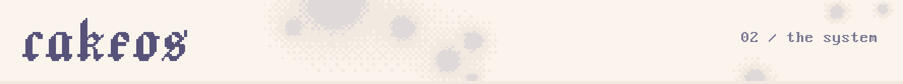
</picture>
</h2>

A personal NixOS flake. One host (`cakeos`) is built from shared modules; what a machine gets is decided at install time and written to `gen/`: a **desktop** (hecate, GNOME or Plasma), **package groups** (gaming, creative, development, office, communication, media, flatpak), hardware extras and the kernel.

<h3 id="install">
<picture>
  <source media="(prefers-color-scheme: dark)" srcset="docs/readme/s-install-dark.png">
  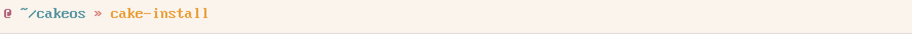
</picture>
</h3>

<p>
<picture>
  <source media="(prefers-color-scheme: dark)" srcset="docs/readme/boot-dark.png">
  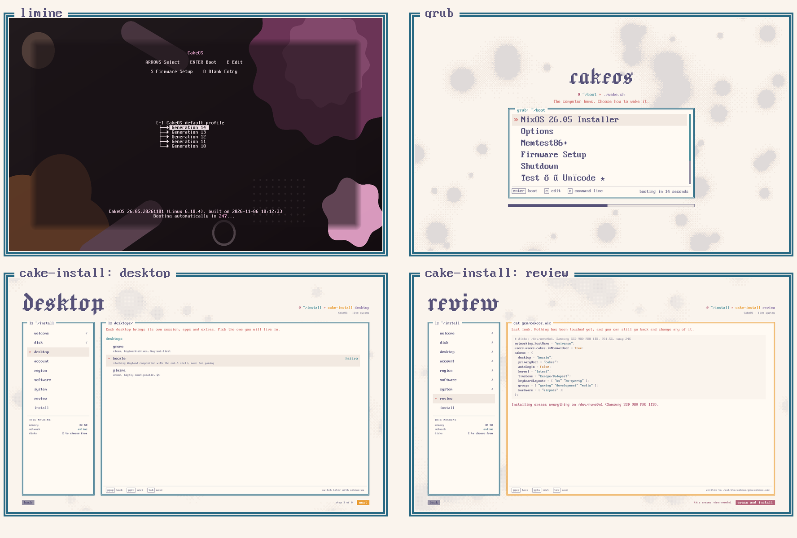
</picture>
</p>

Boot the ISO from the [releases](https://github.com/Kex1016/cakeos/releases) page and the graphical installer starts; `cake-install` is its text twin. To try things without a machine:

```sh
./build-installer.sh vm     # build the ISO and boot it in QEMU
./build-vm.sh hecate        # the hecate desktop in a VM (gnome, plasma work too)
```

<h3 id="switch">
<picture>
  <source media="(prefers-color-scheme: dark)" srcset="docs/readme/s-switch-dark.png">
  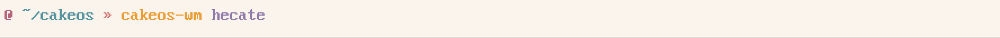
</picture>
</h3>

```sh
update-cakeos               # pull the latest main and rebuild
cakeos-wm switch gnome      # change desktop; each one keeps its own state
```

<h3 id="options">
<picture>
  <source media="(prefers-color-scheme: dark)" srcset="docs/readme/s-options-dark.png">
  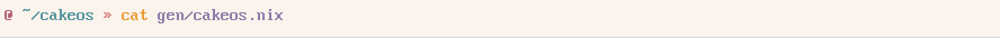
</picture>
</h3>

The installer writes a `cakeos.*` block into `gen/<config>.nix`; edit it later to change your mind. Defaults for what opens what under hecate are options too:

```nix
cakeos.desktop = "hecate";
cakeos.groups = [ "gaming" "development" ];
cakeos.hardware = [ "airpods" ];

cakeos.hecate.defaultApps = {
  fileManager = "org.kde.dolphin.desktop";  # yazi by default
  textEditor = "org.kde.kate.desktop";      # nvim by default
  mimeTypes."image/svg+xml" = "org.kde.okular.desktop";
};
```

<h3 id="claude--apple">
<picture>
  <source media="(prefers-color-scheme: dark)" srcset="docs/readme/s-claude-dark.png">
  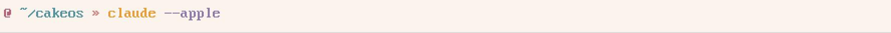
</picture>
</h3>

<p>
<picture>
  <source media="(prefers-color-scheme: dark)" srcset="docs/readme/claude-apple-dark.png">
  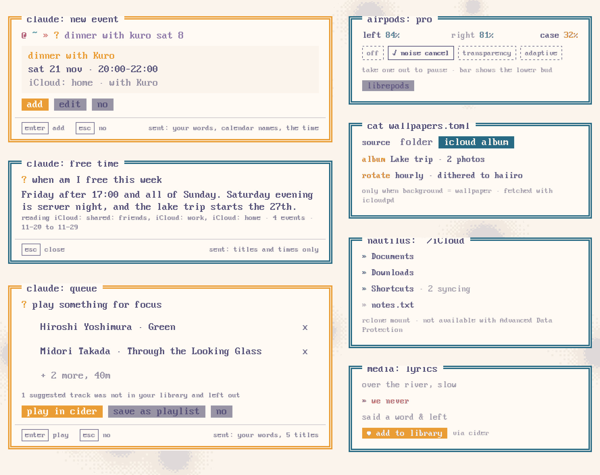
</picture>
</p>

Under hecate the shell can talk to [Claude Code](https://claude.com/claude-code): an ask panel, a sessions panel with permission toasts, a usage widget, and an MCP server for the compositor. Nothing is sent without the chips you can see, and commands only run behind a button. The Apple side (AirPods through librepods, iCloud calendars, contacts, Photos and Drive, Cider) works with what Linux can reach. Both are off until you turn them on: in the shell's settings (services), and for what needs installing, with Home Manager options:

```nix
home-manager.users.<you>.cakeos = {
  # Claude: off by default, each part switched on by itself
  claude.cli.enable = true;    # Claude Code
  claude.shell.enable = true;  # the shell's Claude switch, once
  claude.hooks.enable = true;  # sessions panel and permission toasts
  claude.mcp.enable = true;    # hecate-mcp for Claude Code

  # Apple: off until set up
  apple.icloudpd = { enable = true; username = "you@example.com"; };  # photos
  apple.rclone.enable = true;                                         # drive, at ~/iCloud
};
```

<sub>Fonts: IBM VGA 8x16 from the Ultimate Oldschool PC Font Pack (CC BY-SA 4.0), Jacquard 24 (OFL 1.1), GNU Unifont (OFL 1.1). Images on this page are generated from the haiiro mockups and headless renders of the shell; the light variants recolour the same pixels with Rosé Pine Dawn, since haiiro itself is dark only.</sub>
